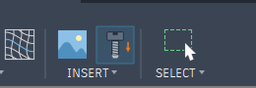
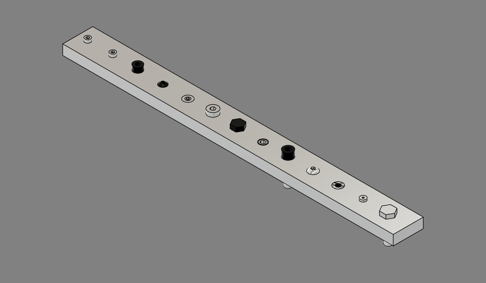

# SR Fastener

A Fusion add-in that places screws and set screws. Pick a type, size, length and finish, click the hole edges,
and SR Fastener builds the screw, puts it in the hole with a rigid joint, and fills in the
BOM part number, description and material.




## What it does

- **Toolbar button** "SR Fastener" in the Design workspace, Solid tab, **Insert** panel (also listed under Utilities > Add-ins).
- **Dialog:** Units, Type, Size, Length, Finish, hole selection, "Match size to first hole",
  "Flip direction", "Cosmetic thread", and a read-only BOM preview.
- **Placing:** pick one or more circular hole edges (the top edge of a hole or of a countersink).
  Each screw is centred on the hole, points into the material, and gets a rigid joint to the hole edge.
- **One component per part number:** the same screw used twice is two occurrences of one component, so
  the BOM counts quantity.
- **BOM fields:** part number, description and Fusion material are set on the component.

The screw geometry is generated from `SRFastener/data/catalog.json`. That way library screws only
come in through this tool, always with the right size, finish and BOM data.

## Screw types

Names and codes follow McMaster-Carr's category names (checked on mcmaster.com 2026-11-16).

| Type (McMaster name) | Code | Standard | Sizes |
|---|---|---|---|
| Socket head screw, metric | SSH | ISO 4762 | M2 to M16 |
| Button head hex-drive screw, metric | SBH | ISO 7380-1 | M3 to M16 |
| Hex-drive flat head screw 90 deg, metric | SFH | ISO 10642 | M3 to M20 |
| Low-profile socket head screw, metric | SLH | DIN 7984 | M3 to M16 |
| Hex head bolt, fully threaded, metric | HHB | ISO 4017 | M3 to M16 |
| Flat-tip set screw, metric | SSF | ISO 4026 | M3 to M12 |
| Cup-tip set screw, metric | SSC | ISO 4029 | M3 to M12 |
| Pan head Phillips screw, metric | SPH | ISO 7045 | M2 to M10 |
| Cheese head slotted screw, metric | SCH | ISO 1207 | M2 to M10 |
| Socket head screw, inch | SSH | ASME B18.3 | #2 to 1/2, UNC and UNF |
| Button head hex-drive screw, inch | SBH | ASME B18.3 | #2 to 1/2, UNC and UNF |
| Hex-drive flat head screw 82 deg, inch | SFH | ASME B18.3 | #2 to 1/2, UNC and UNF |
| Low-profile socket head screw, inch | SLH | ASME B18.3 | #4 to 1/2 UNC, #8 to 1/2 UNF |
| Hex head bolt, inch | HHB | ASME B18.2.1 | 1/4 to 1/2 |
| Flat-tip set screw, inch | SSF | ASME B18.3 | #2 to 1/2, UNC and UNF |
| Cup-tip set screw, inch | SSC | ASME B18.3 | #2 to 1/2, UNC and UNF |

Every family cites its sources in the catalog (dimensions, lengths, thread length and alloy availability
separately), and `tests/test_sources.py` checks rows against them. See [docs/SOURCES.md](docs/SOURCES.md).

What is modeled from the tables: head diameter and height, socket size and depth (set screws use the
shallower socket the standard gives for their shortest lengths), countersink angle (90 deg metric, 82 deg
inch), button and pan crowns (crown radius or side height from the table), slot width and depth, flat-tip and cup-tip
diameters (the cup recess shape itself is not dimensioned in the standards and is drawn as a 118 deg cone), thread pitch, and the threaded length (partly threaded screws get a cosmetic thread of the
tabled length from the tip; shorter ones are threaded to the head).

## Finishes

| Code | Name | Fusion material | Appearance |
|---|---|---|---|
| `18-8 SS` | 18-8 stainless steel | Stainless Steel AISI 304 | Stainless Steel - Satin |
| `18-8 SS-BO` | 18-8 stainless steel, black oxide | Stainless Steel AISI 304 | Coating - Black Oxide |
| `ALLOY-BO` (made-up code) | alloy steel, black oxide | Steel AISI 4142 400 QT (12.9, A574, F835), 4340 350A QT (10.9, Grade 8), 4142 475 QT (45H, F912) | Coating - Black Oxide |

`ALLOY-BO` is offered only for sizes a maker sells in alloy steel black oxide, and the description
carries the grade, e.g. `Socket head screw, ISO 4762, M5 x 0.8 x 16 mm, alloy steel, black oxide, class 12.9`.

| Type | Alloy black oxide | Grade | Who sells it |
|---|---|---|---|
| Socket head, metric | all sizes | class 12.9 | Holo-Krome HK.M.SHCS.12.9.BO |
| Button head, metric | M3 to M12; M16 | class 12.9; class 10.9 | Holo-Krome; IMS (M16) |
| Flat head, metric | M3 to M16 (not M20) | class 12.9 | Holo-Krome HK.M.FHSCS.10642.12.9.BO |
| Low head, metric (DIN 7984) | all sizes | class 10.9 | Brighton-Best (stocked in thermal black oxide) |
| Flat-tip set screw, metric | all sizes | class 45H | Fastener Solutions, Fastenal |
| Cup-tip set screw, metric | all sizes | class 45H | Holo-Krome metric cup point (tech manual) |
| Socket head, inch | all sizes | ASTM A574 | Holo-Krome |
| Button head, inch | all sizes | ASTM F835 | Holo-Krome |
| Flat head, inch | #4 to 1/2 (not #2) | ASTM F835 | Holo-Krome |
| Low head, inch | #8 to 1/2 (not #4, #6) | ASTM A574 | Holo-Krome |
| Hex head bolt, inch | all sizes | SAE J429 Grade 8 | Raptor Supplies listing |
| Flat-tip set screw, inch | all sizes | ASTM F912 | Fastenal |
| Cup-tip set screw, inch | all sizes | ASTM F912 | Holo-Krome alloy cup point, black finish (tech manual) |
| Hex head bolt, metric (ISO 4017) | **not offered** | | only plain or "tempered black" found, not black oxide |

Fusion has no plain "alloy steel" material, and the makers do not name the alloy, so the material is a
quenched-and-tempered Fusion steel whose hardness falls in the grade's range (same density and stiffness).
## Part numbers

These follow the shop's basic hardware codes, which end with the finish:

- `SSH-M3-0.5 x 10 18-8 SS`
- `SBH-M4-0.7 x 12 18-8 SS-BO`
- `SSH-1/4-20 x 1.5 18-8 SS`
- `SFH-8-32 x 0.5 18-8 SS-BO`
- `SBH-10-32 x 0.5 ALLOY-BO` (UNF)
- `SSH-M5-0.8 x 16 ALLOY-BO`

Codes: screws are S + head letter + H, which is the shop's existing SSH/SBH/SFH/SLH pattern; the external hex
is a hex head bolt, HHB (Daniel's name; McMaster sells it as Hex Head Screws);
set screws are SS + tip letter (SSF flat-tip, SSC cup-tip).
Codes not in the shop list yet: `HHB` (named by Daniel), `SSC`, `SSF`, `SPH`, `SCH` and the finish `ALLOY-BO`.
If a screw is bought from McMaster-Carr, use McMaster's part number on the BOM instead. The tool
stores the vendor part number as `TBD`.

## Install

1. Clone this repo.
2. In Fusion: **Utilities > Add-ins > Scripts and Add-ins > Add-ins tab > + (green plus)**, and pick the
   `SRFastener` folder inside the clone. Tick **Run on Startup** and click **Run**.

   Or copy or link the `SRFastener` folder into
   `%APPDATA%\Autodesk\Autodesk Fusion 360\API\AddIns\` and restart Fusion.
3. The button shows up in the Insert panel.

Settings (last type, size, length, finish) are saved in `%APPDATA%\SRFastener\settings.json`.

## Known gaps (TBD)

- **Stocked lengths and vendor part numbers:** McMaster-Carr pages need a browser that runs scripts, so they
  could not be read; lengths come from the standards' preferred-length tables (or a maker's maximum length)
  where cited, and are marked unverified in [docs/SOURCES.md](docs/SOURCES.md) where not. Vendor part numbers are `TBD`.
- **Screw types not yet in the tool:** see [docs/MISSING-SCREWS.md](docs/MISSING-SCREWS.md).
- **Thread detail:** threads are cosmetic (Fusion thread feature), not modelled.
- **Phillips recess:** shown as two crossed slots sized from ISO 7045 (`m` and mean gauge penetration); the
  true ISO 4757 wing shape is not modeled. Cheese head sides are straight (ISO 1207 allows up to 5 deg taper).
- **Hand test:** clicking through the dialog by hand has not been done yet. The live test drives the
  same placement code from a script.

## Development

```
python tools/build_catalog.py   # regenerate SRFastener/data/catalog.json
python tools/check.py           # repo safety scan + catalog freshness + unit tests
```

`dev/fusion_smoke.py` is a live test that runs inside Fusion (through a Python bridge or the Scripts
dialog). It opens a new design, cuts a plate with 29 holes, places every type in every finish (alloy black
oxide in each family that offers it, a UNF screw, cup-tip set screws, the pan and cheese heads, and partly threaded screws),
checks the part number, description, material, appearance, position, tip depth, joint, reuse, toolbar
button, and that partial cosmetic threads have the tabled length and start at the tip, then closes the
design without saving.



## Rules for this repo

This repo is public. Keep secrets, machine paths and vendor CAD files out of it. See [AGENTS.md](AGENTS.md).
