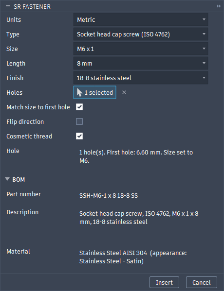

# SR Fastener

A Fusion add-in that places screws. Pick a type, size, length and finish, click the hole edges,
and SR Fastener builds the screw, puts it in the hole with a rigid joint, and fills in the
BOM part number, description and material.




## What it does

- **Toolbar button** "SR Fastener" in the Design workspace, Solid tab, **Insert** panel (also listed under Utilities > Add-ins).
- **Dialog:** Units, Type, Size, Length, Finish, hole selection, "Match size to first hole",
  "Flip direction", "Cosmetic thread", and a read-only BOM preview.
- **Placing:** pick one or more circular hole edges (the top edge of a hole or of a countersink).
  Each screw is centred on the hole, points into the material, and gets a rigid joint to the hole edge.
- **One component per part number:** the same screw used twice is two occurrences of one component, so
  the BOM counts quantity.
- **BOM fields:** part number, description and Fusion material are set on the component.

The screw geometry is generated from `SRFastener/data/catalog.json`. That way library screws only
come in through this tool, always with the right size, finish and BOM data.

## Screw types

| Type | Standard | Sizes |
|---|---|---|
| Socket head cap screw, metric | ISO 4762 | M2 to M16 |
| Button head socket cap screw, metric | ISO 7380-1 | M3 to M16 |
| Flat head socket cap screw 90 deg, metric | ISO 10642 | M3 to M20 |
| Low head socket cap screw, metric | DIN 7984 | M3 to M16 |
| Hex head screw, fully threaded, metric | ISO 4017 | M3 to M16 |
| Socket set screw, flat point, metric | ISO 4026 | M3 to M12 |
| Socket head cap screw, inch | ASME B18.3 | #2 to 1/2 |
| Button head socket cap screw, inch | ASME B18.3 | #2 to 1/2 |
| Flat head socket cap screw 82 deg, inch | ASME B18.3 | #2 to 1/2 |
| Low head socket cap screw, inch | ASME B18.3 | #4 to 1/2 |
| Hex head cap screw, inch | ASME B18.2.1 | 1/4 to 1/2 |

Every family lists its dimension source URL in the catalog. See [docs/SOURCES.md](docs/SOURCES.md).

## Finishes

| Code | Name | Fusion material | Appearance |
|---|---|---|---|
| `18-8 SS` | 18-8 stainless steel | Stainless Steel AISI 304 | Stainless Steel - Satin |
| `18-8 SS-BO` | 18-8 stainless steel, black oxide | Stainless Steel AISI 304 | Coating - Black Oxide |

## Part numbers

These follow the shop's basic hardware codes, which end with the finish:

- `SSH-M3-0.5 x 10 18-8 SS`
- `SBH-M4-0.7 x 12 18-8 SS-BO`
- `SSH-1/4-20 x 1.5 18-8 SS`
- `SFH-8-32 x 0.5 18-8 SS-BO`

Codes: SSH socket head, SBH button head, SFH flat head, SLH low head, SHX hex head, SSF socket set screw (flat point).
If a screw is bought from McMaster-Carr, use McMaster's part number on the BOM instead. The tool
stores the vendor part number as `TBD`.

## Install

1. Clone this repo.
2. In Fusion: **Utilities > Add-ins > Scripts and Add-ins > Add-ins tab > + (green plus)**, and pick the
   `SRFastener` folder inside the clone. Tick **Run on Startup** and click **Run**.

   Or copy or link the `SRFastener` folder into
   `%APPDATA%\Autodesk\Autodesk Fusion 360\API\AddIns\` and restart Fusion.
3. The button shows up in the Insert panel.

Settings (last type, size, length, finish) are saved in `%APPDATA%\SRFastener\settings.json`.

## Known gaps (TBD)

- **Stocked lengths:** each size offers a standard length series. Whether every length is stocked by a
  given maker has not been checked.
- **Vendor part numbers:** not filled in.
- **Screw types not yet in the tool:** see [docs/MISSING-SCREWS.md](docs/MISSING-SCREWS.md).
- **Thread detail:** threads are cosmetic (Fusion thread feature), not modelled.
- **Hand test:** clicking through the dialog by hand has not been done yet. The live test drives the
  same placement code from a script.

## Development

```
python tools/build_catalog.py   # regenerate SRFastener/data/catalog.json
python tools/check.py           # repo safety scan + catalog freshness + unit tests
```

`dev/fusion_smoke.py` is a live test that runs inside Fusion (through a Python bridge or the Scripts
dialog). It opens a new design, cuts a plate with 13 holes, places one screw of every type in both
finishes, checks the part number, description, material, appearance, position, tip depth, joint,
reuse and toolbar button, then closes the design without saving.


## Rules for this repo

This repo is public. Keep secrets, machine paths and vendor CAD files out of it. See [AGENTS.md](AGENTS.md).
