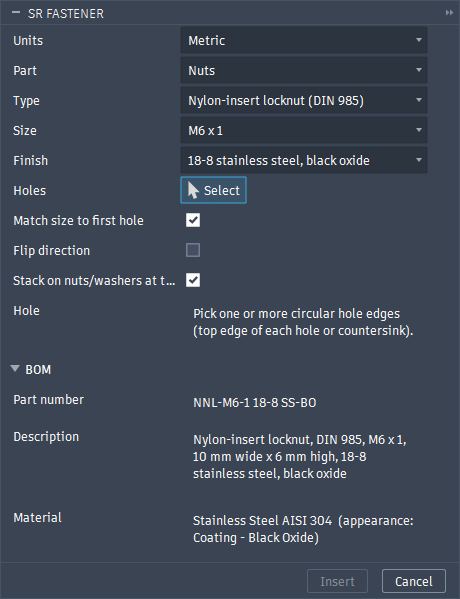

# SR Fastener

A Fusion add-in that places screws, set screws, nuts and washers. Pick a type, size, length and finish, click
the hole edges, and SR Fastener builds the part, puts it on the hole with a rigid joint, and fills in the
BOM part number, description and material.


 

## What it does

- **Toolbar button** "SR Fastener" on more than one panel: by default the Design workspace Solid tab **Insert**
  panel, an **SR Tools** panel on the Solid tab, and Utilities > Add-ins. The panel list is configurable (see
  [Toolbar panels](#toolbar-panels)).
- **Dialog:** Units, Part (screws, nuts or washers), Type, Size, Length (screws only), Finish, hole selection,
  "Match size to first hole", "Flip direction", "Cosmetic thread" (screws only), "Stack on nuts/washers", and a
  read-only BOM preview.
- **Placing:** pick one or more circular hole edges (the top edge of a hole or of a countersink).
  Each screw is centred on the hole, points into the material, and gets a rigid joint to the hole edge.
- **Nuts and washers:** pick the hole edge on the side where the part goes (top edge for a washer under a
  screw head, bottom edge of a through hole for a washer and nut on the thread end). Parts placed on the same
  edge stack: a washer first, then the screw or nut sits on top of it. Place the washer before the screw.
- **One component per part number:** the same screw used twice is two occurrences of one component, so
  the BOM counts quantity.
- **BOM fields:** part number, description and Fusion material are set on the component.

The screw geometry is generated from `SRFastener/data/catalog.json`. That way library screws only
come in through this tool, always with the right size, finish and BOM data.

## Screw types

Names and codes follow McMaster-Carr's category names (checked on mcmaster.com 2026-11-16).

| Type (McMaster name) | Code | Standard | Sizes |
|---|---|---|---|
| Socket head screw, metric | SSH | ISO 4762 | M2 to M16 |
| Button head hex-drive screw, metric | SBH | ISO 7380-1 | M3 to M16 |
| Hex-drive flat head screw 90 deg, metric | SFH | ISO 10642 | M3 to M20 |
| Low-profile socket head screw, metric | SLH | DIN 7984 | M3 to M16 |
| Hex head bolt, fully threaded, metric | HHB | ISO 4017 | M3 to M16 |
| Flat-tip set screw, metric | SSF | ISO 4026 | M3 to M12 |
| Cup-tip set screw, metric | SSC | ISO 4029 | M3 to M12 |
| Pan head Phillips screw, metric | SPH | ISO 7045 | M2 to M10 |
| Cheese head slotted screw, metric | SCH | ISO 1207 | M2 to M10 |
| Socket head screw, inch | SSH | ASME B18.3 | #2 to 1/2, UNC and UNF |
| Button head hex-drive screw, inch | SBH | ASME B18.3 | #2 to 1/2, UNC and UNF |
| Hex-drive flat head screw 82 deg, inch | SFH | ASME B18.3 | #2 to 1/2, UNC and UNF |
| Low-profile socket head screw, inch | SLH | ASME B18.3 | #4 to 1/2 UNC, #8 to 1/2 UNF |
| Hex head bolt, inch | HHB | ASME B18.2.1 | 1/4 to 1/2 |
| Flat-tip set screw, inch | SSF | ASME B18.3 | #2 to 1/2, UNC and UNF |
| Cup-tip set screw, inch | SSC | ASME B18.3 | #2 to 1/2, UNC and UNF |
| Cone-tip set screw, metric | SSN | ISO 4027 | M2 to M12 |
| Cone-tip set screw, inch | SSN | ASME B18.3 | #2 to 1/2 UNC, #10 to 3/8 UNF |
| Extended-tip set screw, metric | SSE | ISO 4028 | M3 to M12 |
| Extended-tip set screw, inch | SSE | ASME B18.3 (half dog) | #2 to 1/2 UNC, #10 to 3/8 UNF |
| Oval-tip set screw, inch | SSO | ASME B18.3 | #4, #6, #8, #10-32, 1/4, 3/8 |
| Flanged button head hex-drive screw, metric | SBF | ISO 7380-2 | M3 to M10 |
| Phillips rounded head sheet metal screw, inch | STP | ASME B18.6.3 head | #2 to #12 |
| Phillips rounded head sheet metal screw, metric | STP | ISO 7049 | M2.2, M2.9, M3.5, M4.2, M4.8, M5.5 |

The newer types (SSN, SSE, SSO, SBF, STP) have no alloy black oxide. Their lengths are exactly the lengths
McMaster stocks. Short inch set screws that Holo-Krome's key engagement tables do not cover use the size's
standard socket depth, cut back where needed to leave a quarter diameter of metal above the point (listed in
[docs/SOURCES.md](docs/SOURCES.md)). Sheet metal screws get no cosmetic thread (Fusion has no tapping-screw thread), and the inch
tip is drawn one diameter long (its length is not in the sources). Cone and extended tips start at the thread
root, as the standards specify.

Every family cites its sources in the catalog (dimensions, lengths, thread length and alloy availability
separately), and `tests/test_sources.py` checks rows against them. See [docs/SOURCES.md](docs/SOURCES.md).

What is modeled from the tables: head diameter and height, socket size and depth (set screws use the
shallower socket the standard gives for their shortest lengths), countersink angle (90 deg metric, 82 deg
inch), button and pan crowns (crown radius or side height from the table), slot width and depth, flat-tip and cup-tip
diameters (the cup recess shape itself is not dimensioned in the standards and is drawn as a 118 deg cone), thread pitch, and the threaded length (partly threaded screws get a cosmetic thread of the
tabled length from the tip; shorter ones are threaded to the head).

## Nuts and washers

Names and codes follow McMaster-Carr's category names. Dimensions are what McMaster lists for its 18-8
stainless stock, cross-checked with the standard or a maker data sheet (see [docs/SOURCES.md](docs/SOURCES.md)).
Every size comes in 18-8 SS and 18-8 SS-BO (black oxide uses the same dimensions as plain 18-8).

| Type (McMaster name) | Code | Standard | Sizes |
|---|---|---|---|
| Hex nut, metric | NHX | DIN 934 | M3 to M20 |
| Thin-profile hex nut, metric | NTH | DIN 439 B | M3 to M16 |
| Nylon-insert locknut, metric | NNL | DIN 985 | M3 to M20 |
| Flange nut, metric | NFL | ISO 4161 (M5 to M12), McMaster (M3, M4) | M3 to M12 |
| Serrated flange nut, metric | NSF | ISO 4161 / DIN 6923 | M3 to M12 |
| General purpose washer, metric | WGP | ISO 7089 | M3 to M20 |
| Oversized washer, metric | WOV | ISO 7093-1 | M3 to M20 |
| Split lock washer, metric | WSL | DIN 127 B | M3 to M20 |
| External-tooth lock washer, metric | WTE | DIN 6797 A | M3 to M20 |
| Internal-tooth lock washer, metric | WTI | DIN 6797 J | M3 to M10 |
| Hex nut, inch | NHX | ASME B18.2.2 | #2 to 1/2, UNC and UNF |
| Thin-profile hex nut, inch | NTH | ASME B18.2.2 (jam) | 1/4 to 1/2, UNC and UNF |
| Nylon-insert locknut, inch | NNL | IFI 100/107 | #2 to 1/2 UNC, #6 to 1/2 UNF |
| SAE washer, inch | WSA | ASME B18.21.1 (SAE) | #2 to 1/2 |
| USS washer, inch | WUS | USS | 1/4 to 1/2 |
| Split lock washer, inch | WSL | ASME B18.21.1 | #2 to 1/2 |
| Flange nut, inch | NFL | inch flange | #4 to 1/2 UNC, #10 to 1/2 UNF |
| Serrated flange nut, inch | NSF | inch serrated flange | #6 to 1/2 UNC, #10 to 3/8 UNF |
| Top-lock distorted-thread locknut, metric | NTL | metric top-lock | M4 to M16 |
| Top-lock distorted-thread locknut, inch | NTL | inch top-lock | #6 to 1/2 UNC, #10 to 1/2 UNF |
| Thin-profile nylon-insert locknut, inch | NTN | inch thin nylon-insert | #4 to 1/2 UNC, #10 to 1/2 UNF |
| Coupling nut, metric | NCP | DIN 6334 | M3 to M20 |
| Coupling nut, inch | NCP | inch coupling | #4 to 1/2 UNC, #10 to 1/2 UNF |
| Cap nut, metric | NCA | DIN 1587 | M3 to M20 |
| Cap nut, inch | NCA | inch cap | #6 to 1/2 UNC, #10 to 1/2 UNF |
| Wing nut, metric | NWG | DIN 315 | M3 to M20 |
| Wing nut, inch | NWG | Style 1 | #6 to 1/2 UNC, #10 to 5/16 UNF |
| Square nut, metric | NSQ | DIN 557 | M5 to M16 |
| Square nut, inch | NSQ | ASME B18.2.2 | #2 to 1/2 UNC, #10 to 3/8 UNF |
| Thick washer, metric | WTK | DIN 7349 | M3 to M20 |
| External-tooth lock washer, inch | WTE | ASME B18.21.1 | #2 to 1/2 |
| Internal-tooth lock washer, inch | WTI | ASME B18.21.1 | #4 to 1/2 |
| Oversized washer, inch | WOV | inch fender | #6 to 3/8 |

Alloy steel black oxide is not offered for nuts and washers. Part numbers have no length:
`NHX-M5-0.8 18-8 SS`, `NHX-1/4-20 18-8 SS-BO`, `NNL-10-32 18-8 SS`, `WGP-M5 18-8 SS`, `WSA-1/4 18-8 SS`.
Descriptions carry the size, e.g. `Split lock washer, DIN 127 B, M6, 6.5 mm ID x 11.8 mm OD x 1.6 mm thick, 18-8 stainless steel`.

Simplified in the model: nut bores are the nominal diameter (no cosmetic thread), the nylon insert is drawn as
part of the hex, the top-lock distortion is not drawn, flange serrations and lock-washer teeth are not drawn,
cap nuts are a hex with a half-sphere dome and a blind bore, wing nuts are a round base with a flat wing plate, and the split-washer gap is as wide as the
washer is thick and flat (not helical).

Where McMaster and the standard differ, McMaster wins and the difference is listed in SOURCES.md, e.g. McMaster's
metric hex nuts are DIN 934 (ISO 4032 is taller from M5 and narrower at M10/M12), and its 1/4 USS washer is
0.750 in OD (Brighton-Best's B18.21.1 table says 0.734).


## Finishes

| Code | Name | Fusion material | Appearance |
|---|---|---|---|
| `18-8 SS` | 18-8 stainless steel | Stainless Steel AISI 304 | Stainless Steel - Satin |
| `18-8 SS-BO` | 18-8 stainless steel, black oxide | Stainless Steel AISI 304 | Coating - Black Oxide |
| `ALLOY-BO` (made-up code) | alloy steel, black oxide | Steel AISI 4142 400 QT (12.9, A574, F835), 4340 350A QT (10.9, Grade 8), 4142 475 QT (45H, F912) | Coating - Black Oxide |

Every screw, nut and washer size is offered in `18-8 SS` and `18-8 SS-BO`. McMaster-Carr is used to check
dimensions, sizes, styles and descriptions, not which finishes it stocks. Alloy black oxide stays only where it
was already offered; special materials (nylon, Grade 8, class 10.9 zinc, brass, aluminum and so on) are not
generated.

`ALLOY-BO` is offered only for sizes a maker sells in alloy steel black oxide, and the description
carries the grade, e.g. `Socket head screw, ISO 4762, M5 x 0.8 x 16 mm, alloy steel, black oxide, class 12.9`.

| Type | Alloy black oxide | Grade | Who sells it |
|---|---|---|---|
| Socket head, metric | all sizes | class 12.9 | Holo-Krome HK.M.SHCS.12.9.BO |
| Button head, metric | M3 to M12; M16 | class 12.9; class 10.9 | Holo-Krome; IMS (M16) |
| Flat head, metric | M3 to M16 (not M20) | class 12.9 | Holo-Krome HK.M.FHSCS.10642.12.9.BO |
| Low head, metric (DIN 7984) | all sizes | class 10.9 | Brighton-Best (stocked in thermal black oxide) |
| Flat-tip set screw, metric | all sizes | class 45H | Fastener Solutions, Fastenal |
| Cup-tip set screw, metric | all sizes | class 45H | Holo-Krome metric cup point (tech manual) |
| Socket head, inch | all sizes | ASTM A574 | Holo-Krome |
| Button head, inch | all sizes | ASTM F835 | Holo-Krome |
| Flat head, inch | #4 to 1/2 (not #2) | ASTM F835 | Holo-Krome |
| Low head, inch | #8 to 1/2 (not #4, #6) | ASTM A574 | Holo-Krome |
| Hex head bolt, inch | all sizes | SAE J429 Grade 8 | Raptor Supplies listing |
| Flat-tip set screw, inch | all sizes | ASTM F912 | Fastenal |
| Cup-tip set screw, inch | all sizes | ASTM F912 | Holo-Krome alloy cup point, black finish (tech manual) |
| Hex head bolt, metric (ISO 4017) | **not offered** | | only plain or "tempered black" found, not black oxide |

Fusion has no plain "alloy steel" material, and the makers do not name the alloy, so the material is a
quenched-and-tempered Fusion steel whose hardness falls in the grade's range (same density and stiffness).
## Part numbers

These follow the shop's basic hardware codes, which end with the finish:

- `SSH-M3-0.5 x 10 18-8 SS`
- `SBH-M4-0.7 x 12 18-8 SS-BO`
- `SSH-1/4-20 x 1.5 18-8 SS`
- `SFH-8-32 x 0.5 18-8 SS-BO`
- `SBH-10-32 x 0.5 ALLOY-BO` (UNF)
- `SSH-M5-0.8 x 16 ALLOY-BO`

Codes: screws are S + head letter + H, which is the shop's existing SSH/SBH/SFH/SLH pattern; the external hex
is a hex head bolt, HHB (Daniel's name; McMaster sells it as Hex Head Screws);
set screws are SS + tip letter (SSF flat-tip, SSC cup-tip, SSN cone-tip, SSE extended-tip, SSO oval-tip);
SBF is a flanged button head and STP a Phillips rounded head sheet metal (tapping) screw.
Nuts are N + two letters (NHX hex, NTH thin-profile, NNL nylon-insert locknut, NFL flange, NSF serrated
flange, NTL top-lock, NTN thin nylon-insert locknut, NCP coupling, NCA cap, NWG wing, NSQ square); washers are
W + two letters (WGP general purpose, WSA SAE, WUS USS, WOV oversized, WSL split lock, WTE/WTI external/internal
tooth lock, WTK thick).
Codes not in the shop list yet: `HHB` (named by Daniel), `SSC`, `SSF`, `SPH`, `SCH`, `SSN`, `SSE`, `SSO`, `SBF`, `STP`, all the nut and washer codes, and the finish `ALLOY-BO`.
The Fusion part number, component name and description always use this smart scheme, never a
McMaster or other vendor number. McMaster catalog numbers stay in [docs/SOURCES.md](docs/SOURCES.md)
as the dimension source only.

## Install

1. Clone this repo.
2. In Fusion: **Utilities > Add-ins > Scripts and Add-ins > Add-ins tab > + (green plus)**, and pick the
   `SRFastener` folder inside the clone. Tick **Run on Startup** and click **Run**.

   Or copy or link the `SRFastener` folder into
   `%APPDATA%\Autodesk\Autodesk Fusion 360\API\AddIns\` and restart Fusion.
3. The button shows up in the Insert panel, the SR Tools panel and Utilities > Add-ins.

Settings (last type, size, length, finish) are saved in `%APPDATA%\SRFastener\settings.json`.

## Toolbar panels

The button can go on any number of Fusion toolbar panels. To change where it shows, copy
[panels.example.json](panels.example.json) to `%APPDATA%\SRFastener\panels.json`, edit it, and stop and run the
add-in (or restart Fusion). Without that file the defaults are used: Insert (on the panel face), SR Tools (a panel the
add-in creates on the Solid tab, on the panel face) and Utilities > Add-ins (in the drop-down).

| Key | Meaning |
|---|---|
| `panel` | Fusion toolbar panel id, e.g. `InsertPanel`, `SolidCreatePanel`, `SolidScriptsAddinsPanel`, or a new id such as `SRToolsPanel` |
| `workspace` | workspace id, default `FusionSolidEnvironment` (Design) |
| `tab` | tab id used to create a new panel, default `SolidTab` |
| `name` | name shown for a panel the add-in creates |
| `create` | `true` to create the panel if it does not exist |
| `promote` | `true` to show the button on the panel face, not only in its drop-down |

An entry can also be just the panel id as a string. Bad entries are skipped and listed in a message when the add-in
starts. On stop the add-in removes every button it added, the command, and any panel it created that is left
empty (other SR add-ins can share the SR Tools panel).

## Known gaps (TBD)

- **Stocked lengths and vendor part numbers:** McMaster-Carr pages need a browser that runs scripts, so they
  could not be read; lengths come from the standards' preferred-length tables (or a maker's maximum length)
  where cited, and are marked unverified in [docs/SOURCES.md](docs/SOURCES.md) where not. Vendor part numbers are `TBD`.
- **Screw, nut and washer types not yet in the tool:** see [docs/MISSING-SCREWS.md](docs/MISSING-SCREWS.md).
- **Stacking under a screw already placed:** a washer added after its screw does not push the screw up; place
  the washer first.
- **Thread detail:** threads are cosmetic (Fusion thread feature), not modelled.
- **Phillips recess:** shown as two crossed slots sized from ISO 7045 (`m` and mean gauge penetration); the
  true ISO 4757 wing shape is not modeled. Cheese head sides are straight (ISO 1207 allows up to 5 deg taper).
- **Hand test:** clicking through the dialog by hand has not been done yet. The live test drives the
  same placement code from a script.

## Development

```
python tools/build_catalog.py   # regenerate SRFastener/data/catalog.json
python tools/check.py           # repo safety scan + catalog freshness + unit tests
```

`dev/fusion_smoke.py` is a live test that runs inside Fusion (through a Python bridge or the Scripts
dialog). It opens a new design, cuts a plate with 41 holes, places every type in every finish (alloy black
oxide in each family that offers it, a UNF screw, cup, cone, extended and oval tip set screws, the pan and cheese heads, flanged button heads, sheet metal screws, and partly threaded screws),
checks the part number, description, material, appearance, position, tip depth, joint, reuse, toolbar
button, and that partial cosmetic threads have the tabled length and start at the tip. A second plate with
17 holes gets every nut and washer type, stacked under screw heads and on the thread end, and checks the seat
height of each stacked part, its direction, thickness, outside size and joint. Then it closes the design
without saving.


## Rules for this repo

This repo is public. Keep secrets, machine paths and vendor CAD files out of it. See [AGENTS.md](AGENTS.md).
